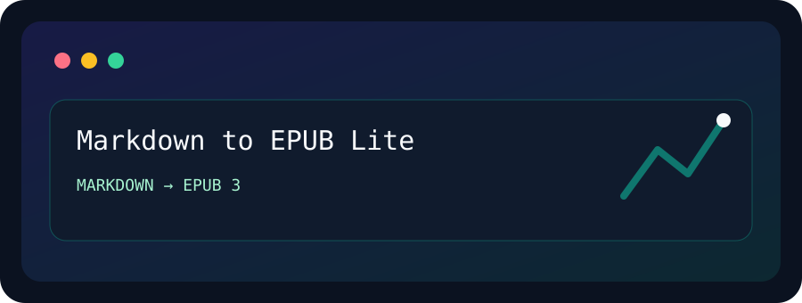

<div align="center">


[](LICENSE)
[](https://www.python.org/)
[](https://github.com/CyberLoop-dev/md2epub-lite/stargazers)
[](https://github.com/CyberLoop-dev/md2epub-lite/commits/main)

**A tiny Markdown-to-EPUB 3 converter with no external packages.**



</div>

## 🧭 Overview

Markdown to EPUB Lite converts a practical subset of Markdown into a valid EPUB 3 archive. It creates the required package metadata, navigation document, XHTML chapter, stylesheet, and correctly ordered mimetype entry.

## ✨ Features

- 📘 Builds an EPUB 3 archive from one Markdown file.
- 🧱 Supports headings, paragraphs, lists, blockquotes, and fenced code.
- 🧭 Generates a navigation table of contents from headings.
- 📦 Uses only Python's standard library and zipfile.
- 🔒 Converts local files without network access.

## 🖥️ Demo

```bash
python main.py examples/chapter.md -o chapter.epub --title "A Small Guide" --author "Example Author"
```
Open the generated EPUB in any compatible ebook reader.

## 🚀 Quick Start

```bash
git clone https://github.com/CyberLoop-dev/md2epub-lite.git
cd md2epub-lite
python main.py examples/chapter.md -o chapter.epub
```

## 🧱 Tech Stack

- 🐍 Python 3.10+
- 📦 Standard library: html, uuid, zipfile, xml-safe string generation

## 🗂️ Folder Structure

```text
md2epub-lite/
├── main.py
├── examples/chapter.md
├── tests/test_main.py
├── pyproject.toml
├── assets/illustration.svg
├── .gitignore
└── README.md
```

## 🛣️ Roadmap

- [x] EPUB 3 package and navigation
- [x] Basic Markdown blocks
- [ ] Inline image embedding

## 🤝 Contributing

Issues and pull requests are welcome. Please include a clear reproduction or sample input and keep changes focused.

## 📄 License

Released under the [MIT License](LICENSE).

<div align="center">


</div>
